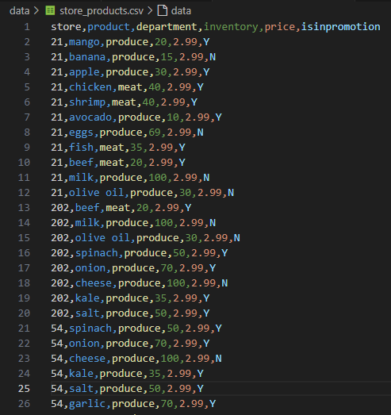
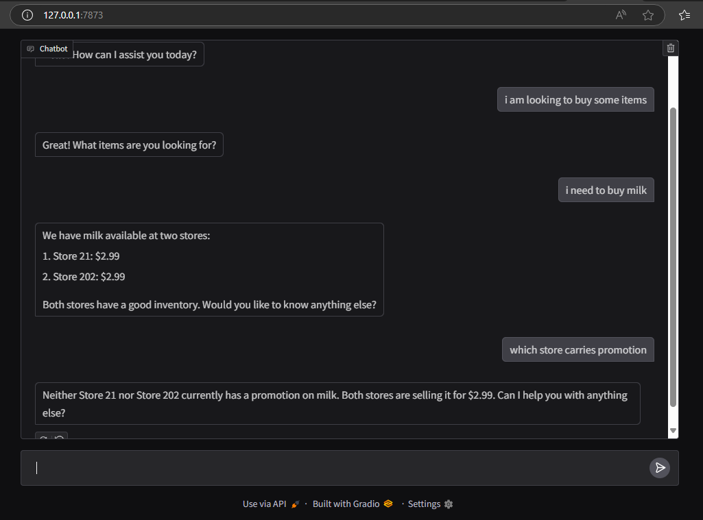
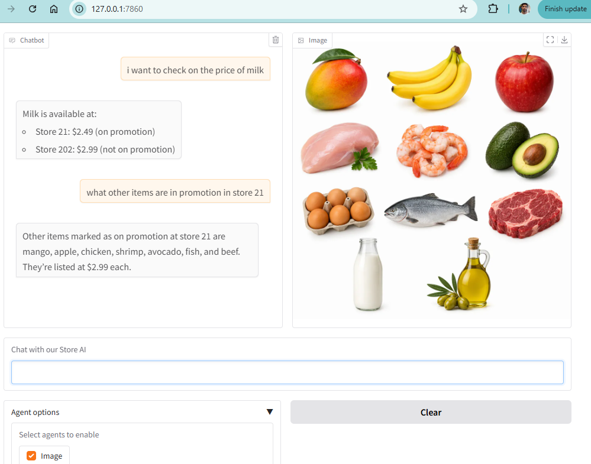
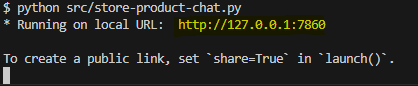

<h1 align="center"># AI chat for Retail chain </h1>
This is a baseline for an AI project / product for retail industry

The AI looks up store inventory and responds to customer questions.

Gradio provides the chat interface. Chat inference and image generation use separate configurable API endpoints, credentials, and models.

The store product data is fed from a csv file and can be replaced by a DB or some service feed

<p align="center">
    
</p>

## Simple Chat
The `chat` function takes the user's message prompts and processes the LLM invocation to respond to the user's message
The `tool_call` is handled by `handle_tool_call` method which calls the custom method to get the product details for the inquired product 

```python
    def chat(self, message, history):
        """
        method with signature appropriate to be used for Gradio chat interface
        """
        messages = [{"role": "system", "content": self.system_message}] + history + [{"role": "user", "content": message}]
        response = self.openai.chat.completions.create(model=self.MODEL, messages=messages, tools=self.tools, tool_choice="auto")
        
        if response.choices[0].finish_reason=="tool_calls":
            message = response.choices[0].message
            response = self.handle_tool_call(message)
            messages.append(message)
            messages.append(response)
            response = self.openai.chat.completions.create(model = self.MODEL, messages=messages)
                            
        return response.choices[0].message.content

```

Above chat method is configured to capture the interaction through the simple Gradio's ChatInterface method.

```python
    gr.ChatInterface(fn=StoreProductChat().chat, type="messages").launch()
```

<p align="center">
    
</p>

The chat inventory lookup can filter results to products currently on promotion using the optional `promotion_only` argument. Promotion status is read from the `isinpromotion` column in the product data.

## Chat with Image Agent
This `chat` extends simple chat with an optional image agent. When product information is returned, the image agent generates a clean, realistic grocery-store-style collage of the requested products.
The Gradio interface lets you enable the image agent and displays its generated image alongside the chat, as shown below.
<p align="center">
    
</p>

## Setup
Copy `.env.template` to `.env` and configure the provider settings:

- `INFERENCE_BASE_URL`, `INFERENCE_API_KEY`, and `INFERENCE_MODEL` configure chat completions.
- `IMAGE_BASE_URL`, `IMAGE_API_KEY`, and `IMAGE_MODEL` configure image generation.
- `STORE_PRODUCTS_FILE` selects the CSV file under `data/`.

Keep real credentials in your local `.env`; do not commit it. The Dockerfile currently copies `.env` into the image at build time, so do not publish or share an image built with real credentials.

## Usage

Install the base dependencies and start the Gradio chat:
```
uv sync
uv run src/store-product-chat.py
```

Alternatively, install from `requirements.txt` and run with Python:
```
pip install -r requirements.txt
python src/store-product-chat.py
```
Navigate to the local `url` displayed and start chatting



## MCP Server in Docker

The MCP image defaults to Streamable HTTP on port 8000. Build and run it from the repository root:

```text
docker build -f mcp.Dockerfile -t retail-chain-mcp .
docker run --rm -p 8000:8000 retail-chain-mcp
```

Connect an MCP client to `http://localhost:8000/mcp`. The server code defaults to stdio when run directly; set `MCP_TRANSPORT=http` to use HTTP outside Docker.

## Input Guardrails

The MCP and Gradio paths validate user-controlled search values before they
reach the data layer or the LLM. Built-in checks detect common prompt-injection
phrases and mask email addresses, phone numbers, card numbers, SSNs, and
API-key-like values. Optional Presidio, DeBERTa, and Detoxify checks can add
entity recognition, prompt-injection detection, and toxicity detection.

The `.env.template` enables the optional detectors. For a lightweight setup,
disable them with `GUARDRAIL_ENABLE_PRESIDIO=false`,
`GUARDRAIL_ENABLE_DEBERTA=false`, and `GUARDRAIL_ENABLE_DETOXIFY=false`; built-in
checks remain available. To install the optional dependencies, run:

```text
uv sync --extra guardrails
```

The model checks may use substantial memory and download model files on first
use. Their thresholds are configured by `GUARDRAIL_INJECTION_THRESHOLD` and
`GUARDRAIL_TOXICITY_THRESHOLD` in `.env`.
